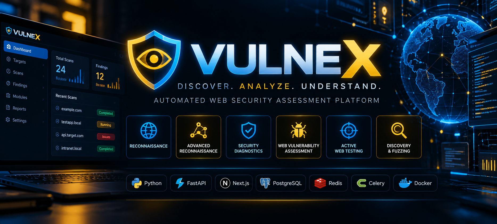
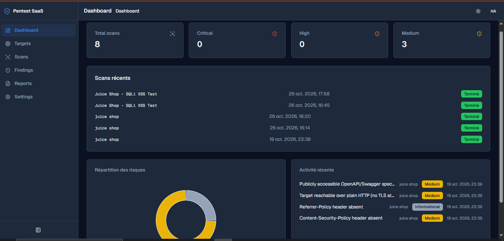
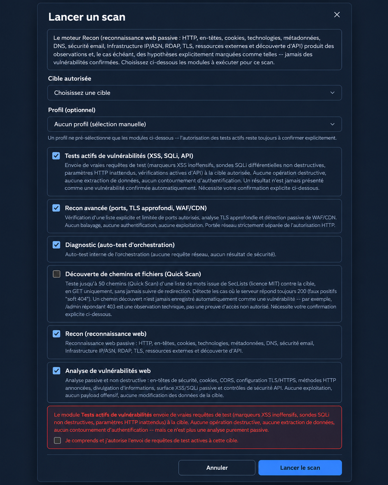
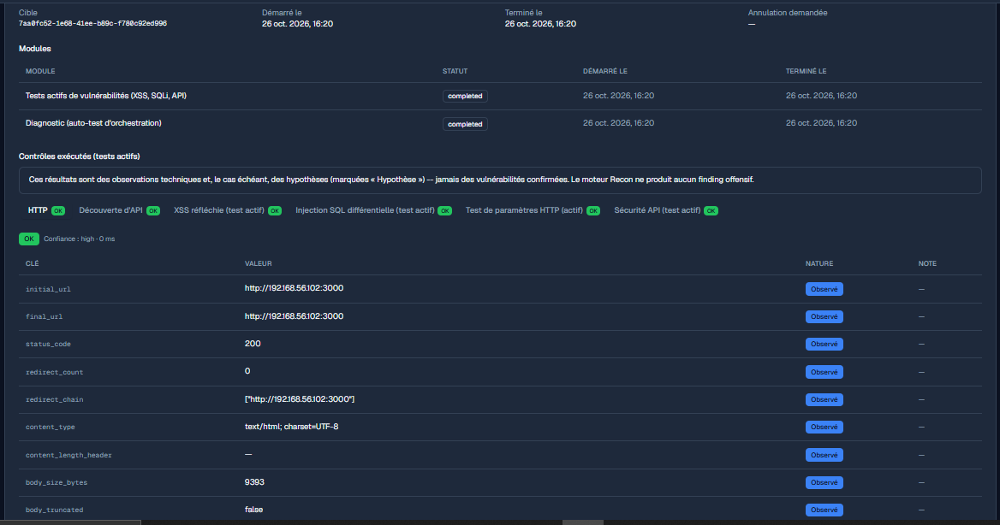
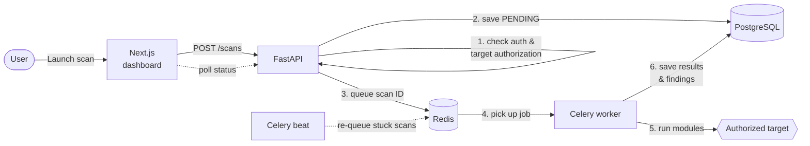

<p align="center"></p>

<div align="center">

# VULNEX

### Discover. Analyze. Understand.

**An automated web security assessment platform, built to be safe by design.**


</div>

---

## What is VULNEX?

VULNEX automates the repetitive part of a web penetration test.
You add a target you are authorized to test, pick the modules you want,
and launch a scan. VULNEX runs it in the background, from passive
reconnaissance up to controlled XSS and SQL injection checks, then gives
you findings ranked by severity and a PDF or HTML report.

A scanner sends requests to systems it doesn't own, so it is a great
target for attackers too. That is why the platform itself was designed
with the same care as the scans: SSRF protection with IP pinning,
active testing locked behind five independent gates, and findings that
are never presented as confirmed without proof.

## Preview

### Security dashboard

Scans, findings by severity, risk distribution and recent activity at a glance.

<p align="center">
  
</p>

### Choosing what to scan

Six modules, from passive observation to controlled active testing.

<p align="center">
  
</p>

*Illustrative expanded view of the scan configuration interface.*

### Results you can trust

Every check, its status and the evidence behind each observation.

<p align="center">
  
</p>

## How a scan works



- **The API never waits for a scan.** Scans run in a separate Celery
  worker, so a long or crashing scan never slows down the dashboard.
- **No scan is ever lost.** A scan is saved in PostgreSQL *before* it is
  queued. If Redis is down, it stays pending and a maintenance task
  scheduled by Celery beat re-queues it.
- **Every status change is race-safe.** One conditional SQL update
  controls the whole lifecycle (`PENDING → QUEUED → RUNNING → COMPLETED`),
  so a late worker can never overwrite a cancelled scan.

## Modules

| | Module | What it does | Type |
|---|---|---|---|
| 🔎 | **Reconnaissance** | HTTP, security headers, cookies, technologies, DNS, SPF/DMARC/DKIM, TLS certificate, RDAP, IP/ASN, external assets, API endpoints in the page, changes since the last scan | Passive |
| 🛰️ | **Advanced reconnaissance** | Authorized ports and services, supported TLS versions and certificate chain, WAF/CDN detection | Passive |
| 🛡️ | **Web vulnerability assessment** | Missing security headers, weak cookie flags, CORS misconfiguration, risky HTTP methods, information disclosure, exposed API specs, injection surface | Passive |
| ⚡ | **Active web testing** | Reflected XSS, SQL injection (differential, non-destructive), parameter handling, API error handling | Active · off by default |
| 🗂️ | **Discovery & fuzzing** | Hidden paths with a SecLists wordlist, with soft-404 detection | Active · off by default |
| 🧪 | **Diagnostic** | Self-test of the scan orchestration (no network) | Internal |

Passive modules run first to understand the target. Active tests come
last: they are noisier and riskier, and only make sense once you know
where to look.

## Security by design

**🚫 SSRF protection with IP pinning**
Every outbound request is checked against the *real* IP address after
DNS resolution, so `localhost`, private networks and cloud metadata
addresses are refused, even behind an innocent-looking domain name.
Active tests then connect to that exact validated IP, which closes the
DNS rebinding window.

**🔐 Active testing behind five gates**
An active module only runs if it is enabled in the database, enabled in
the deployment settings, confirmed by the user for *this* scan, the
target is in that module's own allowlist, and every request passes the
SSRF check.

**🧪 Non-destructive detection**
- XSS: a harmless marker checks whether `< > " '` come back unescaped,
  and in which context (HTML, attribute, script). No script is ever run.
- SQL injection: the normal page is measured first to learn its noise,
  then compared with a quote probe and a true/false condition pair.
- Every signal must reproduce before it becomes a finding.
- No UNION, no time-based payloads, nothing that writes. GET, HEAD and
  OPTIONS only.

**🧾 Honest findings**
Each finding has a severity, a CWE, an OWASP category, a confidence level
and the evidence behind it. A missing header is never "critical", and an
XSS indicator without browser proof stays at low confidence.

**👤 Solid authentication**
Argon2id password hashing, server-side sessions with hashed tokens,
HttpOnly/Secure/SameSite cookies, CSRF tokens bound to the session,
Redis-backed rate limiting, and identical responses (message *and*
timing) whether an account exists or not.

**🎯 Authorized targets only**
Every scan re-checks that the target is authorized, with a reference and
a date, and records who authorized it.

## Tech stack

| Layer | Technologies |
|---|---|
| Frontend | Next.js 16, React 19, TypeScript, Tailwind CSS, Radix UI |
| Backend | Python, FastAPI, Pydantic, SQLAlchemy (async), Alembic |
| Database | PostgreSQL |
| Background jobs | Celery worker, Celery beat, Redis |
| Scanning | httpx, dnspython, cryptography |
| Reports | reportlab (PDF), Jinja2 (HTML) |
| Infrastructure | Docker, Docker Compose |

## Quick start

```bash
git clone https://github.com/hajar-el-assouti/vulnex.git
cd vulnex/backend
cp .env.example .env          # set POSTGRES_PASSWORD and SECRET_KEY
docker compose up -d --build  # PostgreSQL, Redis, API, worker, beat

cd ../frontend
cp .env.example .env.local    # BACKEND_INTERNAL_URL=http://localhost:8000
npm ci && npm run build && npm run start
```

Full guide: [docs/INSTALLATION.md](docs/INSTALLATION.md) ·
Backend details: [backend/README.md](backend/README.md) ·
Frontend details: [frontend/README.md](frontend/README.md)

## Project structure

```
vulnex/
├── backend/
│   ├── app/
│   │   ├── api/         REST endpoints
│   │   ├── services/    business logic
│   │   ├── tasks/       Celery tasks, one module per engine
│   │   ├── engines/     recon, web_vuln, active_web_testing, discovery_fuzzing
│   │   ├── security/    SSRF and network-scan authorization
│   │   └── models/      database tables
│   ├── alembic/         migrations
│   └── docker-compose.yml
├── frontend/
│   └── src/             Next.js pages, features, API client
└── docs/
```

## Limitations and roadmap

VULNEX is an evolving project and its checks can produce false positives
or false negatives. Known limits and next steps:

- [ ] Verify target ownership automatically (DNS TXT record or file)
- [ ] Confirm XSS findings in a sandboxed headless browser
- [ ] Add CVSS scores to findings
- [ ] Standard and Deep modes for discovery & fuzzing
- [ ] Continuous integration on GitHub

## Author

Built by **Hajar El Assouti**, cybersecurity engineering student at
ENSA Oujda.

---

<div align="center">

**For authorized security testing only.**
Never scan a system you don't own or don't have written permission to test.

</div>
